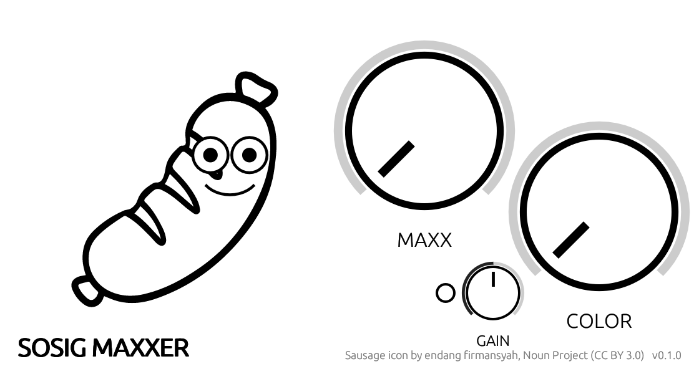
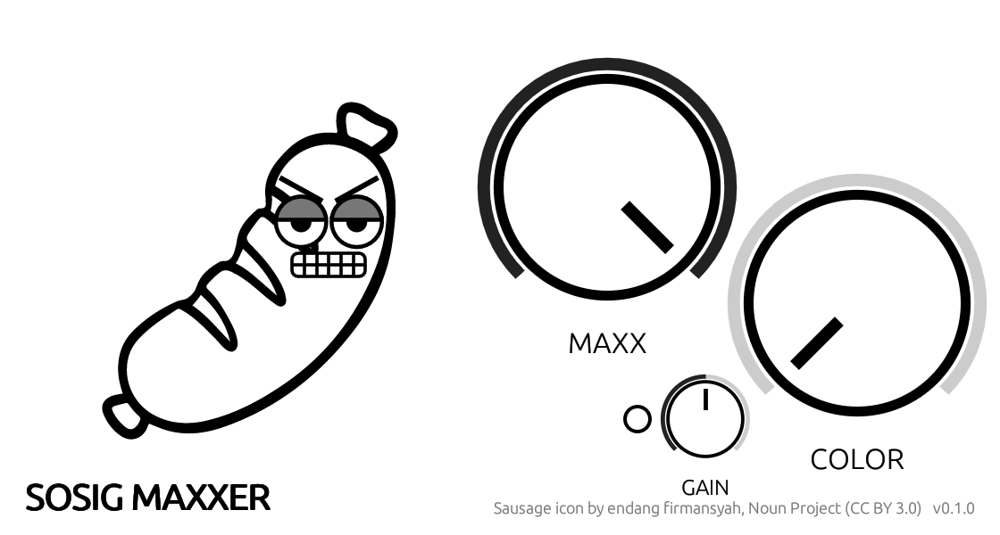

# Sosig Maxxer

| Maxx 0% | Maxx 100% |
|---|---|
|  |  |

<!-- regenerate: cargo test --release --lib -- --ignored readme_screenshots -->

Free saturator plugin (VST3 + CLAP) for macOS, Windows and Linux. Three knobs:

- **Maxx** — drive (+39 dB over its range) into a linked peak limiter and hard clipper. Higher Maxx
  also lets more peak through, so it gets louder *and* grittier.
- **Color** — a +8 dB tone bell, placed before the drive, that sweeps from 46 Hz to 6.7 kHz.
  Wherever it points is what saturates first.
- **Gain** — more drive (−35 to +37 dB). It acts like an output level only when nothing is clipping.

Starting points: bass and leads at Maxx 55 / Color 20, 808s at Maxx 90 / Color 35, master bus at
Maxx 8 / Color 10.

## Install

Download the zip for your OS from [Releases](https://git.popat.org/agenttux/sosig-maxxer/releases),
then copy `Sosig Maxxer.vst3` (and `Sosig Maxxer.clap` if your DAW supports CLAP) to:

| OS | VST3 | CLAP |
|---|---|---|
| macOS | `~/Library/Audio/Plug-Ins/VST3/` | `~/Library/Audio/Plug-Ins/CLAP/` |
| Windows | `C:\Program Files\Common Files\VST3\` | `C:\Program Files\Common Files\CLAP\` |
| Linux | `~/.vst3/` | `~/.clap/` |

The macOS builds are ad-hoc signed, not notarized. After copying, clear the quarantine flag:

```bash
xattr -dr com.apple.quarantine ~/Library/Audio/Plug-Ins/VST3/"Sosig Maxxer.vst3" ~/Library/Audio/Plug-Ins/CLAP/"Sosig Maxxer.clap"
```

Then rescan plugins in your DAW. In FL Studio that is Options → Manage plugins → Find plugins;
in Ableton, enable VST3 in Settings → Plug-Ins.

## Build

```bash
cargo xtask bundle sosig_maxxer --release   # target/bundled/
cargo test
```

## How it was made

The DSP comes from black-box measurement only: test signals in, audio out, then fit a model. The
laws, the fitting log and the match results are in [docs/spec/behavior.md](docs/spec/behavior.md).
`analysis/` contains the harness:
- `compare.py` nulls any two plugins, or a plugin against the numpy model.
- `listen.py` renders blind A/B pairs.

### End-to-end null test (macOS)

Phase-cancels the reference plugin against ours, or against the model, over every test clip and preset at
44.1, 48, 88.2, 96 and 192 kHz. A residual ≤ −25 dB counts as a pass on the Splice presets, and ≤ −20 dB on
the extremes.

1. Set up Python:
   ```bash
   python3 -m venv .venv && .venv/bin/pip install -r analysis/requirements.txt
   ```
2. Build and install ours:
   ```bash
   cargo xtask bundle sosig_maxxer --release && cp -R "target/bundled/Sosig Maxxer.vst3" ~/Library/Audio/Plug-Ins/VST3/
   ```
3. Install the reference plugin yourself (it is not in this repo).
4. Optionally, build the local corpus. It is gitignored and never committed:
   - `bash analysis/corpus/fetch_fl.sh` copies FL Studio factory samples (FL Studio must be installed).
   - `bash analysis/corpus/fetch_songs.sh` downloads 8 CC BY songs (~49 MB, 8 genres) and cuts 24 clips.

   Without it, only the 8 synthesized clips are used.
5. Run it from `analysis/`. It exits 1 on a failure, and the optional third argument picks the rates:
   ```bash
   cd analysis && ../.venv/bin/python compare.py ~/Library/Audio/Plug-Ins/Components/<reference>.component \
     ~/Library/Audio/Plug-Ins/VST3/"Sosig Maxxer.vst3" 44100,48000
   ```

Plugin binaries and audio files are gitignored. `.githooks/pre-commit` refuses them too; enable it once per
clone with `git config core.hooksPath .githooks`.

## Releases

Every push to `main` is tagged. Forgejo CI builds and attaches the Linux and Windows bundles. The
macOS bundle is built on a Mac by `scripts/publish-mac.sh`, which the pre-push hook triggers. To
enable the hook, run this once per clone:

```bash
git config core.hooksPath .githooks
```

## License

GPL-3.0-or-later. The VST3 bindings that nih-plug uses are GPLv3.

## Credits

Sausage icon: "Sausage" by endang firmansyah from the [Noun Project](https://thenounproject.com/icon/sausage-7391865/),
CC BY 3.0. See `assets/ATTRIBUTION.md`.
